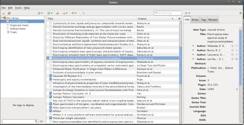
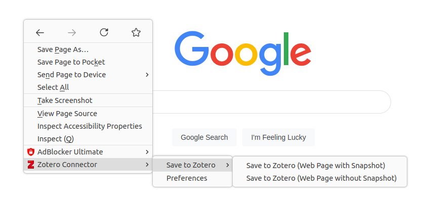
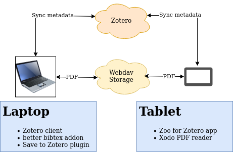
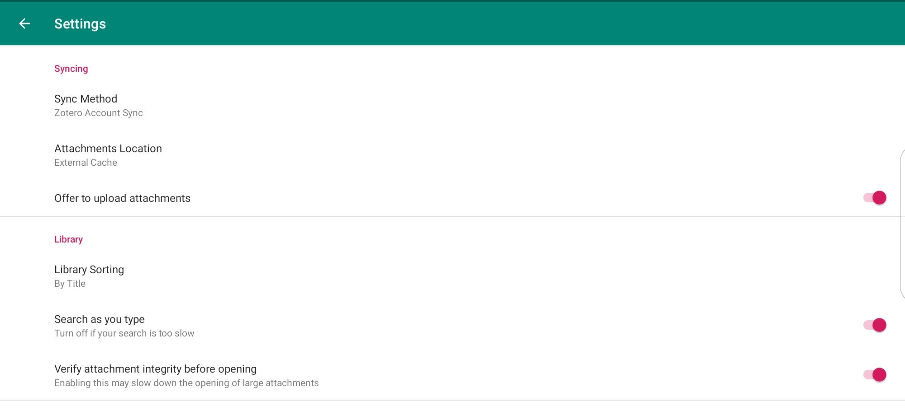
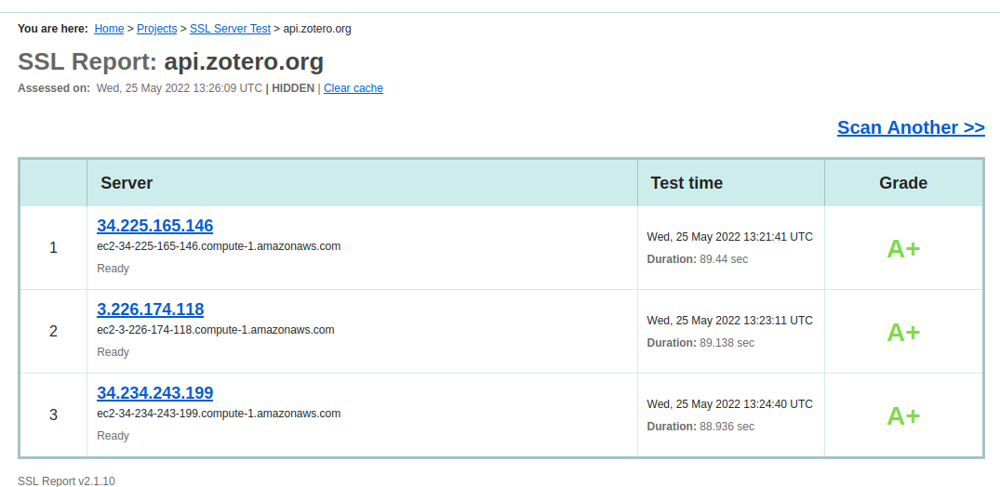

A common problem for researchers is reference management. During your studies, you will read a lot of papers. At some point, you realize: "I need to manage my references properly". 
Luckily, there are several options for reference management, like [Mendeley](https://www.mendeley.com/), [Endnote](https://endnote.com/), [JabRef](https://www.jabref.org/) and [Zotero](https://www.zotero.org/). In this article, I will highlight Zotero. I am going to show you how to set up Zotero in such a way that:
1) Files and metadata get synchronized
2) PDF highlights and notes get synchronized as well
3) It is easy to add new resources
I will also do a short privacy and security analysis so that you are aware of the risks. 

# Zotero

The first thing I like about Zotero is that it is open-source. You can check the code if you have doubts about the quality. They offer a web-based and stand-alone client. The interface is simple and to the point:

Zotero has all the standard functionality you are looking for like, searching, adding attachments, generating BibTex files, and adding resources. There is automatic metadata retrieval, so you don't have to fill in anything. Adding resources is even easier with the browser connector.

The [browser connector](https://www.zotero.org/download/connectors) is available for firefox, chrome, safari, and edge.
The plugin supports several types of data. PDF metadata is extracted automatically. For webpages, there is a snapshot functionality.
It works simple. Open the desktop client and go to the folder where you want to store it. The connector will connect to the desktop client and the "Save to Zotero" option will become available.

There are a plethora of [plugins](https://www.zotero.org/support/plugins) available for Zotero. 

Zotero has support for groups. Groups allow for collaboration. There are however some limitations. For example, WebDAV is not supported in groups. The main reason is that usually, not all members have access to the same WebDAV storage. That is why I ignored groups for my setup.

You can use Zotero without an account. However to synchronize data you will need an account. Zotero offers 300MB of free cloud storage. A paid subscription will give you more storage. 
Data is split up into metadata and files. Metadata is always synchronized with Zotero. For file synchronization, you have the option of using your  WebDAV storage provider. 

# My Setup
I work mainly from my laptop. I also use an Android tablet for casual reading. Notes must get synchronized between devices.
My setup looks as follows:

So my laptop runs the Zotero Desktop client, which is available for Windows, Mac, and Linux. I used the better BibTex plugin to generate bib files. I also used the browser plugin to add resources quickly.
I enabled Zotero sync only for metadata. For PDF files and other attachments, I use WebDAV. 
On my tablet, I run Zoo for Zotero. To synchronize PDF notes, you must enable "Offer to upload attachments" and "Verify attachment integrity before opening". It is also important that you use a PDF reader which stores the annotated PDF in the same file. Xodo is a PDF reader which works. Adobe, for example, does not work. 

This setup not only synchronizes files but also PDF highlights and notes. Note that you cannot work on the same file at the same time on both devices. Also, you can swap WebDAV with Zotero file storage easily. Just be aware that there is only 300MB of free storage.

# Security and privacy analysis

In our scenario, the metadata is synchronized with Zotero. The files themselves are not. The files are synchronized with your WebDAV provider.
So it is important to know that Zotero knows which books, papers, or articles you are reading. In their [privacy statement](https://www.zotero.org/support/privacy) they state that they do not sell you personal information. They do collect your IP address and store errors if they occur. In their [security statement](https://www.zotero.org/support/security ) they mention that data is encrypted using AES-256. The data is stored in America. Their API receives an A+ score from SSL labs.

Because Zotero is open-source you have the option of running locally. For experienced server administrators, this might be an option. For most people, this will be too much effort.
The code for Zotero can be found on [github]( https://github.com/zotero). 

# Conclusion

If you are a fan of open-source software (like I am), then Zotero is a great option. It integrates well into my workflow. The save to Zotero plugin allows for easy capture of resources. Combined with the automatic metadata retrieval there is not a lot of bookkeeping.

The setup for file syncing, including PDF notes and highlights, is possible, although it requires some work. You have to enable Zotero syncing for this, which brings some security and privacy risks.
If you want to go the extra mile you can install the Zotero server yourself.