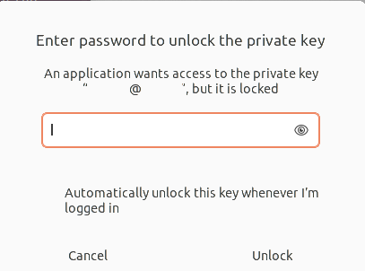
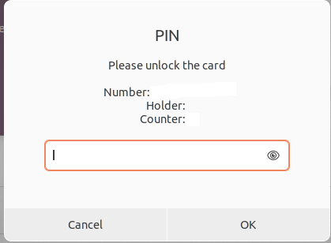
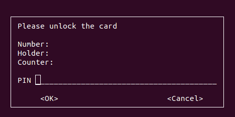

When logging on to a server by SSH using certificate authentications, the operating system asks to unlock the certificate by providing the passphrase. This passphrase is usually not known and has to be copied from a password manager. However, the OS provides a GUI prompt where it is not possible to change to the password manager. This does not only apply to SSH, but also GPG. The following images shows the problem.


In this article I will explore how this can be solved. There are several solutions. First of all, it is possible to hook up the passphrases to the Gnome keyring, so it gets unlocked at startup. The second option is to change the input from GUI to terminal (for terminal applications). The third option is to use a GUI prompt where you can copy and paste. Fourth option would be to hook up your password manager with the unlock mechanism.

The fourth option is too specific to explain here. It is dependent on your system setup. Solution 3 is infeasible. The whole point of the input mechanism is secure. To my understanding allowing users to switch back and forth to the password input prompt is a security violation. Therefore, we will explore the first two solutions, right after giving some background information.

# Background
In Ubuntu passwords and secrets are managed through the [gnome-keyring](https://en.wikipedia.org/wiki/GNOME_Keyring). Every key you own can be added to this ring, just like a physical key-ring. To manage the keys you can use [Seahorse](https://en.wikipedia.org/wiki/Seahorse_(software)). Gnome-keyring can manage both GPG and SSH keys. SSH and GPG keys are managed through [ssh-agent](https://www.ssh.com/academy/ssh/agent) and [gpg-agent](https://www.systutorials.com/docs/linux/man/1-gpg-agent/) respectively. The pin prompt for GPG is called pinentry.

We won't go into details about these tools or why it is important to protect your secrets. The rest of this blog post will describe some solutions without compromising security.

# Solution 1
By adding the passphrase to the keyring we do not have to unlock it all the time. After you unlocked the keyring at the login, you can just ssh to the server without providing the passphrase.
The advantage is that it is easy and fast. The disadvantage: if you leave your computer unlocked anybody can access your server using ssh. But, you should not leave your computer unlocked anyways.

I could only find out how to do this for ssh. There are two ways to add the passphrase to the keyring. The first one is really simple, when connecting it will ask for the passphrase. Just input the passphrase and click 'remember', like in the image below. Another way is by using 'ssh-add'
```bash
x@y:~$ ssh-add ~/.ssh/[privkey]
Enter passphrase for ~/.ssh/[privkey]: 
Identity added: ~/.ssh/[privkey]: (x@y)
```

# Solution 2
Apparantly, SSH asking for the passphrase using a GUI prompt is some kind of [bug](https://askubuntu.com/questions/722712/how-do-i-configure-ssh-to-ask-me-for-my-password-in-the-terminal-instead-of-in-a). If there are any public keys in ~/.ssh it will ask for the passphrase using the GUI. An option is to move the public keys to another directory. In the following snippet I moved all public keys to a new directory called .ssh-pub.
```bash
x@y:~$ mkdir ~/.ssh-pub
x@y:~$ mv ~/.ssh/*.pub ~/.ssh-pub
```
You should get the following terminal prompt next time: 
```bash
x@y:~$ ssh x@x -i ~/[privkey] 
Enter passphrase for key '[privkey]': 
```

For GPG it is easier. GPG uses a program called pinentry. Using update-alternatives you can set it to cli, gui, or curses.
```bash
x@y:~$ sudo update-alternatives --config pinentry
There are 3 choices for the alternative pinentry (providing /usr/bin/pinentry).

  Selection    Path                      Priority   Status
------------------------------------------------------------
* 0            /usr/bin/pinentry-gnome3   90        auto mode
  1            /usr/bin/pinentry-curses   50        manual mode
  2            /usr/bin/pinentry-gnome3   90        manual mode
  3            /usr/bin/pinentry-tty      30        manual mode

Press <enter> to keep the current choice[*], or type selection number: 1
update-alternatives: using /usr/bin/pinentry-curses to provide /usr/bin/pinentry (pinentry) in manual mode
x@y:~$ 
```
In the following image it shows the input entry through curses: 

# Conclusion
I think solution 1 is the way to go. It is easier to use because you don't need to fill in the password all the time. This only works for SSH. 
For GPG I recommend option 2. The PIN code is usually short, so that should be easy to remember.
Some recommendations to end this blog post with:
* Do not leave your computer unlocked
* Do not remove passphrase from your private keys
* Do not login as root using SSH
* Protect root account with a secure password
* Use secure authentication mechanisms in general