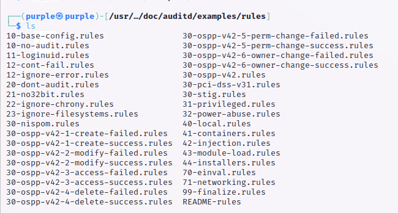

Auditd is a monitoring tool for Linux systems developed by Red Hat. It can be used to monitor file changes, user access, system calls and more. Auditd does not prevent security breaches but notifies the user what is happening to the system. Some of the use-cases mentioned at the [RedHat Documentation Website](https://access.redhat.com/documentation/en-us/red_hat_enterprise_linux/7/html/security_guide/chap-system_auditing) are monitoring file access, system access (through system calls), and record security events. Auditd is mentioned in the [CIS benchmark](https://www.cisecurity.org/cis-benchmarks) for generic Linux systems as an essential module for system hardening.

One of the challenges is the configuration of auditd. Auditd collects logs based on user-defined rules. If you are interested in user access to a certain file or directory, but you did not define a rule for it, it will not be collected by auditd. So, which set of rules capture every relevant event on the operating system? This can be device specific: every device has a different purpose, runs different software, etc. However, most Linux systems also have a lot in common. That is why in this article we will look at the rulesets based on standards or certifications, like STIG, NISPOM, PCI-DSS, and OSPP. It also leads to the question why server distributions are not shipped with preconfigured rules for system hardening.

This article will cover the following:
1. **Basic auditd concepts: searching, reporting, and rules**
2. **Existing rulesets based on security standard like NISPOM, CIS, and OSPP**
3. **Difficulties of auditd and future work**

The question we want to answer in specific is: "which standard is the best choice as the default ruleset for auditd server installations?".

# Basic auditd concepts
The core concept of auditd is very simple. It logs all the events happening on a system, if the user has defined a rule for this.
Installation of auditd can be done through the package manager, 'sudo apt install auditd' or 'sudo dnf install auditd'.
## Searching
All logs are located in /var/log/audit.log by default. You can do some simple grepping on this file. Auditd also has a utility called "ausearch". Use "man ausearch" to see all the options.

## Reporting
One of the best features of auditd is the reporting functionality. With the command "aureport" you can get a summary of all auditd events. It also allows for more specific use-cases. For example, if you want to have a report on all successful logins you can use "aureport -l --success". For the complete set of reporting options, look at "man aureport". These reports can be delivered to your personal mailbox. Check out my earlier [blog post](https://www.folmer.info/blog/confidential-linux-server-reports-using-mailx-and-pgp) on how to do this!

One of the caveats with monitoring is that you need to make sure that the timeranges are overlapping. For example, if you do a daily report make sure that there is a bit of overlap, otherwise important events might be missed.

## Rules
The rules auditd uses are located in /etc/audit/audit.rules. To add a new rule, don't change this file directly. Either add a new .rules file in /etc/audit/rules.d/ or add new rules to /etc/audit/rules.d/audit.rules. Rules can be renewed with "augenrules --load".

There are three types of rules. Control rules, file system rules, and system call rules. These rules tell auditd what kind of events to collect. A complete overview of the possibilities can be found on [this website](https://access.redhat.com/documentation/en-us/red_hat_enterprise_linux/7/html/security_guide/sec-defining_audit_rules_and_controls). 

There is a caveat with reloading rules. It is a good security practice to lock the configuration with "auditctl -e 2". This prevents users from changing the config without rebooting the machine. It looks like this also applies to rule changes, so a reboot in locked mode is required.

## Integration
Auditd can be combined with other tools like Splunk or Wazuh.
However, currently this requires quite a lot of setup.
Firstly, auditd needs to be configured to log the system.
Secondly, the flexibility of auditd means that it can log a lot of events. This has implications on the monitoring systems: how do we integrate this data?
An ongoing development direction would be to construct a good set of rules(standard-based) and provide a proper interface between this ruleset and the monitoring system(like Wazuh or Splunk).

# Standards
The main challenge of using auditd is deciding on the set of rules to use. To faciliate this problem, Red Hat has sets of predefined rules. Some of these sets are based on standards or certifications used in the industry. We cover five standards here, [OSPP v4.2.3](https://commoncriteria.github.io/pp/operatingsystem/operatingsystem-release.html), [NISPOM](https://www.federalregister.gov/documents/2020/12/21/2020-27698/national-industrial-security-program-operating-manual-nispom), [STIG](https://public.cyber.mil/stigs/), [PCI-DSS](https://www.pcisecuritystandards.org/) and [CIS](https://www.cisecurity.org/cis-benchmarks). I am not knowledgable on all of them, so I won't go into details about the differences between the standards. Some rulesets are already available. They are usually available under '/usr/share/doc/auditd/examples/rules' or '/usr/share/doc/audit/rules' depending on the operating system. The following image shows the rulesets on a Kali Purple operating system.

## OSPP
The [Operating System Protection Profile(OSPP) ](https://commoncriteria.github.io/pp/operatingsystem/operatingsystem.html) describes the security funcionality for operating systems in terms of common criteria.
There seem to be a lot of rulesets for OSPP available in auditd. I just inspect the default file: '30-ospp-v42.rules'. It seems to monitor access to the auditd facilities, user/group creation/changes, and privilege escalation among others.

## NISPOM
The [National Industrial Security Program Operating Manual](https://www.federalregister.gov/documents/2020/12/21/2020-27698/national-industrial-security-program-operating-manual-nispom) is a ruleset developed by the department of defense(US). From the documentation:
> The NISPOM establishes requirements for the protection of classified information disclosed to or developed by contractors, licensees, grantees, or certificate holders (hereinafter referred to as contractors) to prevent unauthorized disclosure.

The focus here seems to be on unsuccessful events and watching important files like '/etc/passwd' and '/etc/shadow'.
## STIG
The [Security Technical Implementation Guides (STIG)](https://public.cyber.mil/stigs/) is also maintained by the department of defense.
The specific difference between STIG and NISPOM eludes me a bit.
Looking at the rules, it seems pretty similar to NISPOM.
## PCI-DSS
The [Payment Card Industry Data Security Standard](https://www.pcisecuritystandards.org/) is, like the name says, developed by the payment card industry.
It seems to have a similar goal to the other guides. It might be better tailored to financial use-cases.
However, when inspecting the rules in '30-pci-dss-v31.rules' it looks very similar to other standards. 
They did annotate the rules so it indicates cleary which part of the standard the rules are implementing.
## CIS
The [CIS benchmark](https://www.cisecurity.org/cis-benchmarks) also has some recommendations, although they are not provided as examples by auditd. 
The standard mainly makes sure that all relevant information gets logged. Also, CIS explains how auditd needs to be setup in a secure way.
From my point of view this is probably the best standard to implement since all rules are thoroughly explained.
However, implementation is a bit more difficult since we have to go through the standard itself.

# Limitations and Future Directions
Auditd is a great auditing tool, but there are limitations.
Firstly, the default ruleset is empty and defining own rules is time consuming. A secure default ruleset is needed.
Secondly, integration with monitoring tools is provided but too flexible. There needs to be a coupling between auditd configuration and monitoring tools.
Lastly, there is performance overhead. So, maybe there are better performing alternatives available.

Standards can help provide a good default ruleset.
However, the standards suffer from a few problems:
1. How are requirements(standard) converted to rules?
2. Does the ruleset match all the requirements?
3. What standard is the most 'secure'?

So, what standard to choose for the default auditd ruleset?
In my opinion, a good candidate would need to clearly document which rule matches which requirement.
Also, it should explain why each requirement is necessary for a secure system.

# Conclusion
In short, we see good potential for the use of auditd:
1. auditd should come with a preloaded ruleset that matches a well-defined standard to increase system hardening
2. auditd should be more tightly integrated with monitoring tools like Wazuh or Splunk

More research is needed to determine exactly what each standard is doing with auditd and how they compare to each other. An interesting research direction is to investigate how auditd can be used with monitoring tools in a secure way. Another interesting question is "what is the best baseline ruleset for server hardening?". Given that the standards have similar goals: what are the differences between them and which one of them is the best choice?

I believe that well-known server distributions should come with some generic rules preloaded.
This ruleset should adhere to one or more standards to make it compliant.
Doing this, reduces the effort of server administrators significantly.
My recommendation would be to consider the [CIS benchmark](https://www.cisecurity.org/cis-benchmarks) because it does not only give and motivate the rules but also gives auditd hardening tips.
