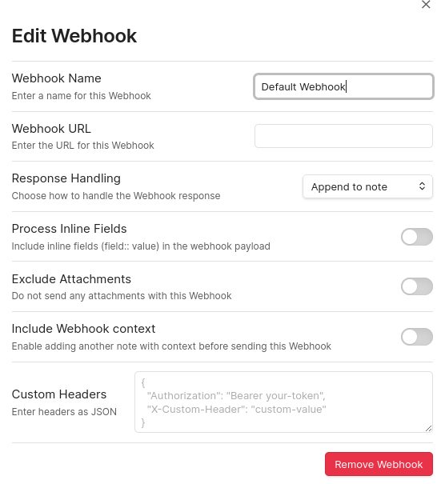
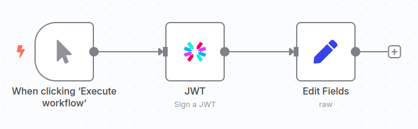
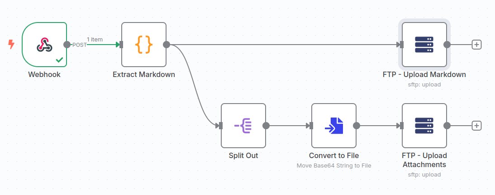
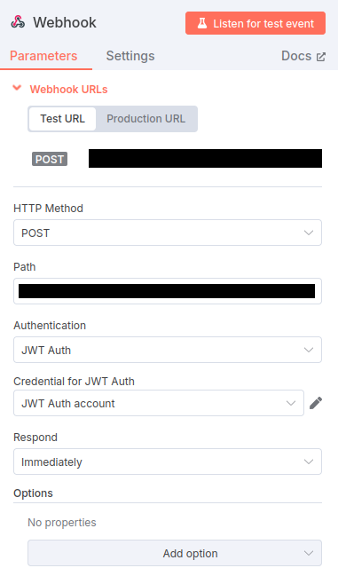

I keep most of my notes in [Obsidian](https://obsidian.md/). Obsidian is a fantastic tool. It supports **Markdown**, **LaTeX equations**, **tables**, and much more. I noticed that my website, which uses [Grav CMS](https://getgrav.org/), also utilizes Markdown. This made me wonder: is it possible to publish an article directly from Obsidian? Since Obsidian already offers a similar feature in their pro subscription, it seems feasible.

In short, what I want to achieve is simple. I want to write an article (like this one) in Obsidian. Highlight the article with metadata. Click a button from within Obsidian that publishes the article as a blog post on my [website](https://folmer.info). Furthermore, I want this process to be **secure** and **reliable**.

To achieve this, I decided to use an automation tool called [N8N](https://n8n.io/). N8N is available as a service, but it also offers the option to self-host, which is free!

# Requirements
For this tutorial, you will need:
1. [Obsidian](https://obsidian.md/)
2. [Obsidian Webhook Plugin](https://github.com/Masterb1234/obsidian-post-webhook)
3. [N8N](https://n8n.io/) (self-hosted or online)
4. A webserver with SFTP Access

# Background and Setup
Before going into the solution, I will give a brief overview of the technologies used in this tutorial.

## Obsidian
Obsidian is a note-keeping application for Windows, Linux, and Mac. It is very versatile and flexible. It uses markdown to write notes. Follow the [Installation Guide](https://help.obsidian.md/install) to install Obsidian. 

Obsidian supports metadata fields for each not. So, I use these metadata fields to annotate my articles. For this tutorial, I use the following fields:
```markdown
---
title: Publishing Articles Automatically with Obsidian and N8N
description: This article explains the process of automatically publishing articles using Obsidian and N8N.
author: Folmer
tags:
  - article
  - obsidian
  - n8n
created: 2025-07-14
published: 2025-07-14T09:00:00
finished: true
status: Finished
---
```
Note that you don't need to include the same fields. However, if you do decide on including different fields, please change the N8N `Extract Markdown` step (see next section), because it uses these values.

We also need the [Obsidian Post Webhook](https://github.com/Masterb1234/obsidian-post-webhook) plugin. We will explain later what a webhook does. Basically, a webhook is an end-point where our note will be send. The Post Webhook Plugin is easy to configure. Just provide a name, URL, and some optional headers.

<!--  -->


The custom headers is important in our case because we will include an authentication field for security purposes.
## N8N
N8N is an automatization platform. A user can specify workflows. A workflow can be triggered automatically or manually. It can connect with numerous third-party services through credentials. If you want to learn more, please visit the website of N8N.
If you want to self-host, I recommend using docker compose. Look at the official [GitHub page](https://github.com/n8n-io/n8n-hosting/tree/main/docker-compose/withPostgresAndWorker) to learn how.

In our case, N8N needs to have two credentials: a JSON Web Token and an SFTP account.

### JSON Web Token
Firstly, we need a JSON Web Token (JWT) credential. A JWT works as follows. First, the user generates a random passphrase, which should remain secret. It also specifies a hashing algorithm to be used, like SHA256. The passphrase is shared between the user and the server (N8N). Every subsequent request will include a header that is based on this shared secret. Without the shared secret, other users cannot generate the header. It is important that the header remains secret. Have a look at [the RFC Standard](https://www.rfc-editor.org/rfc/rfc7519) or the [JWT Debugger](https://jwt.io/) for more information.

The token generation is a little bit tricky. What I recommend is setting up a workflow in N8N. This workflow assumes you set up a JWT credential. It will then create a signature and place it in header, which can be copied to Obsidian.



In the edit fields step I used the following to generate a proper HTTP header:
```
{
  "Authorization": "Bearer {{ $json.token }}"
}
```
In Obsidian, go to the webhook configuration and add the end-point.
### SFTP Credential
The SFTP credential is pretty straightforward. Go to `create credential` and fill in the form. Provide the correct hostname, port, username, and password. I recommend using a private key instead of a password. Look at this [Tutorial](https://www.ssh.com/academy/ssh/keygen) on how to do that.
## Grav and Webserver
Grav is a flat-file content management system (CMS). I find it is easier to use for simple websites (like mine). Note that the this tutorial should, with some changes, work for any CMS that can work with markdown files. I won't go into to much details about how to install and setup Grav, that would simply be too much. 
### SFTP
We use SFTP to upload pages to our webserver. Note that this is not the most optimal solution. It would be better to use an API or webhook, but this is something that Grav does not have. With SFTP we have to take care that we follow good security practice. This means that we should use an account which only has access to SFTP (not SSH), can only see the webpages and does not have any other rights. So, using the `root` account for SFTP access is strictly forbidden!

So, what I did is create a new group on my webserver. Users in this group are restricted to only using SFTP and can only see their own files. More precisely, they are chrooted inside their home directory. I create ad user `sftp-user` and added him to the `sftp-group` with the following command: `sudo usermod -aG sftp-group sftp-user``

Change`/etc/ssh/sshd_config` settings to include the following:
```
Subsystem sftp internal-sftp

# add the lines below
Match Group sftp-group
    X11Forwarding no
    AllowTcpForwarding no
    ChrootDirectory %h
    ForceCommand internal-sftp
```

In the home directory, create a new directory for uploads:
```bash
sudo mkdir /home/sftp-user/webpages
sudo chmod 755 /home/sftp-user/webpages
sudo chown [grav-user]:[grav-user] -R /home/u/webpages
sudo setfacl -d -R -m u:sftp-user:rwX,u:[grav-user]:rwX /home/sftp-user/webpages/ 
sudo setfacl -R -m u:sftp-user:rwX,u:[grav-user]:rwX /home/sftp-user/webpages/
```
As can be seen, we set the owner to the grav-user and give others access through an access control list (ACL). We set default ACL values so that all new files get set up with the same access rights. This way everyone can read, write, and edit blog posts.

By doing this we create a user that can do relatively little damage. It cannot access SSH and can only see the files in its home directory.

# N8N Workflow
Now we have everything installed and setup, it is time to create the workflow.

The N8N workflow looks as follows:



In summary, it listens on an URL for incoming request. If it receives something, it parses the markdown. The markdown is then split into two parts, one for the attachments and one for the blog post.
## Webhook
The webhook is the entry point. In essence, it listens on a certain URL for any incoming connections. In this case, it is listening for a HTTP Post request.



As can be seen, we use a JWT credential for authentication. Also notice there are two URL's a testing and production URL. Make sure that the right one is being said in Obsidian.

## Extract Markdown
Parsing data does three things:
1. Create a frontmatter
2. Rewrite wikilinks
3. Select relevant fields
Grav expects markdown files with a frontmatter. A frontmatter, is kind of like a YAML file that contains metadata. An example frontmatter is:
```yaml
---
title: '...'
headline: '...'
author: '...'
date: '...'
published: true/false
publish_date: '...'
taxonomy:
    tag:
        - ...
        - ...
---
```
By default Obsidian uses wikilinks to display images (`![[]]`) and internal links (`[[]]`). However this is not proper markdown and should be replaced by `` and `[]()` respectively. Lastly, not all fields are needed, so we only take a subsection.

To achieve this, we use the following code:
```javascript title:"Markdown Parser" fold
const getCurrentTime = () => new Date().toLocaleString('en-GB', { day: '2-digit', month: '2-digit', year: 'numeric', hour: '2-digit', minute: '2-digit', hour12: false }).replace(/\//g, '-');

title = $json.body.title || $json.body.filename.replace(/\.[^/.]+$/, "") || "";
filename = title.toLowerCase().replace(/[^a-z0-9\s]/g, '').trim().replace(/\s+/g, '-');
headline = $json.body.description || "";
author = $json.body.author || 'Folmer';
tags = $json.body.tags || [];

// use created field if available
datetime = getCurrentTime();
if(!isNaN(Date.parse($json.body.created))) {
  datetime = $json.body.created; 
}

// use published field if available
published = $json.body.finished || true;
published_datetime = getCurrentTime(); 
if(!isNaN(Date.parse($json.body.published))) {
  published_datetime = $json.body.published; 
}

frontmatter = `---\n` +
              `title: '${title}'\n` +
              `headline: '${headline}'\n` +
              `author: '${author}'\n` + 
              `date: '${datetime}'\n` +
              `published: ${published}\n` +
              `publish_date: '${published_datetime}'\n` +
              `taxonomy:\n` +
              `    tag:\n`;
for(tag of tags) {
  frontmatter += `        - ${tag}\n`;
}
frontmatter += `---\n`;

// replace wikilinks with actual markdown
body = $json.body.content.replace(/(!)?\[\[([^\]]+)\]\]/g, (match, exclamation, x) => exclamation ? `})` : `[${x}](${encodeURI(x)})`);
content = frontmatter + body;

// return df
return {"filename": filename, "content": content, "attachments": $json.body.attachments};
```

Now, the data has been parsed, we can send it anywhere we want.

## Split Out and Convert to File
These steps are extremely simple. When exporting markdown, the attachments get included as a base64 string. What we need to do is convert them back into binaries. Which we do by splitting the attachments array into elements and then individually convert them.
## SFTP
The upload phase consists of two steps:
1. Uploading the markdown file
2. Uploading the attachments
The markdown content upload is pretty straight-forward once you have your SFTP access setup. The attachments have to be converted first and will be uploaded one-by-one.
# Activating the Workflow
When activating the workflow, notice the difference between the test URL and production URL. This means that you need to change the URL in Obsidian. A workflow can be activated by pressing the switch in the upper right corner.
# Conclusion
This article has been automatically published from Obsidian, showing that it works. That being said, there are a few things it does not do at the moment. Firstly, it **overwrites** any old data, so if your file already exists it gets destroyed. Secondly, it would be nice to add some **A.I. features** that check for typos. Thirdly, we could add some more **intelligence**. For example, detect if an article gets an update. Lastly, this example workflow works only with SFTP. However, as long as your CMS supports markdown, it is very easy to make changes to suite to your requirements.

If you want, you can specify some extra things in the workflow settings. for example, you can set an error workflow or estimate the time saved.

Please feel free to reach out to me through the comments.
